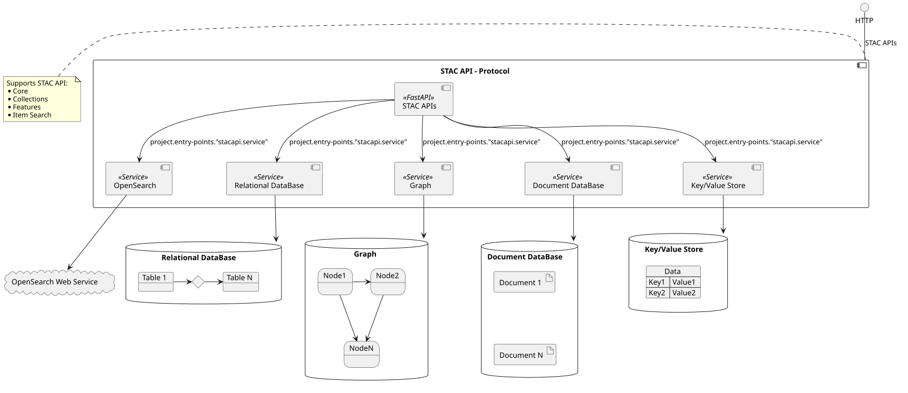

<!--
Copyright 2026 Terradue

Licensed under the Apache License, Version 2.0 (the "License");
you may not use this file except in compliance with the License.
You may obtain a copy of the License at

    http://www.apache.org/licenses/LICENSE-2.0

Unless required by applicable law or agreed to in writing, software
distributed under the License is distributed on an "AS IS" BASIS,
WITHOUT WARRANTIES OR CONDITIONS OF ANY KIND, either express or implied.
See the License for the specific language governing permissions and
limitations under the License.
-->

# STAC API Protocol: A lightweight way to expose existing data

**STAC API Protocol enables existing data systems to become interoperable STAC API services without requiring them to adopt a new catalogue infrastructure.**

Built around a clean separation between the HTTP protocol layer for STAC API _Core_, _Collections_,
_Features_, and _Item Search_ and the underlying data services, it provides the essential STAC API functionality while leaving data access, metadata mapping, and catalogue operations to pluggable implementations.

This makes it particularly suited to building lightweight STAC facades over heterogeneous data sources, from legacy catalogues and REST services to databases, object storage, and custom scientific data systems.

Rather than introducing another catalogue to maintain, STAC API Protocol allows existing systems to expose their data through a common, standards-based interface.

- **Minimal footprint:** Avoid unnecessary catalogue infrastructure, metadata duplication, and synchronization pipelines.
- **Backend agnostic:** Integrate heterogeneous data sources without imposing a common storage technology.
- **Clean separation of concerns:** Keep protocol handling independent from data access and business logic.
- **Reusable deployment:** Maintain one API implementation while deploying different service providers.
- **Extensible integration:** Adapt existing systems through small, dedicated service implementations.
- **Interoperability by design:** Make existing data accessible through the STAC ecosystem with minimal architectural changes.

STAC API Protocol is designed for situations where the challenge is not building another catalogue, but making existing data discoverable and accessible through a standard interface.

Ddeveloped according to **Hexagonal Architecture
(Ports and Adapters)** and the separation of concerns associated with **Clean
Architecture**: **FastAPI acts exclusively as the HTTP adapter**, separating the
STAC API protocol layer from the underlying data access and implementation logic.

Each source can have its own:
- Data model
- Metadata representation
- Query mechanism
- Identifier scheme
- Asset location
- Authentication mechanism
- Search capabilities and limitations
The facade only needs to translate these capabilities into the STAC API contract.

The provider is discovered through a fixed entry-point contract, and the deployed environment supplies the implementation.

This brings some important practical benefits:

- No environment-specific forks of the API application.
- No backend-specific logic in the protocol layer.
- Simpler deployment packaging because the provider can be a separate Python distribution.
- Better maintainability because protocol upgrades and data-source implementations evolve independently.
- Reuse across organizations and infrastructures, even when the underlying systems differ substantially.

This is particularly compelling for organizations operating several data platforms with different technologies, interfaces, or metadata schemas.

This makes `stac-api-protocol` particularly useful when the objective is to wrap existing data services, not build another centralized metadata database.

## A better fit for federation and distributed infrastructures

This architecture also aligns naturally with distributed catalogue environments.

Instead of forcing every data provider to consolidate its metadata into a central catalogue, each provider can expose its own STAC API facade. A higher-level discovery service can then federate or aggregate those interfaces.

This allows you to preserve:

- Data sovereignty;
- Existing operational boundaries;
- Local access control policies;
- Technology diversity;
- Independent provider evolution.

The STAC API becomes the common language between systems, rather than a requirement for all systems to share a common implementation.

For distributed infrastructures, this is often a more natural model than centralizing metadata ownership.

`stac-fastapi` is probably a good choice when:

- Your data already exists elsewhere.
- The source already provides some discovery or query capabilities.
- You want to avoid duplicating metadata.
- You need to map different data models into STAC.
- You want the smallest possible implementation between your data and STAC clients.
- You want a single reusable API deployment with interchangeable service providers.

Its modularity and extension ecosystem are real advantages.

## Main advantages of `stac-api-protocol`

There are architectural benefits of adopting the protocol/service separation:

### 1. Clear separation of concerns

The protocol layer owns HTTP, routing, request validation, serialization, and protocol-level errors. The implementation owns data access, query translation, metadata mapping, and domain logic.

### 2. Backend-agnostic by design

You are not required to adopt a specific storage technology or catalogue database. Existing systems remain the source of truth; STAC is the interoperability layer placed on top of them.

### 3. Minimal runtime and operational footprint

A facade can avoid deploying and maintaining a dedicated STAC metadata database, ingestion pipeline, synchronization jobs, and indexing infrastructure when the underlying source already provides the information required.

### 4. Reuse the same API implementation

The HTTP and STAC implementation can be reused across multiple deployments. Only the source-specific service implementation changes.

### 5. Pluggable service implementations

Backend implementations can be installed independently and discovered at runtime, avoiding the need to fork or modify the API application for each deployment.

### 6. No forced data migration or duplication

Metadata can be mapped on demand from the source system into STAC representations, reducing synchronization problems and the risk of maintaining multiple versions of the same catalogue information.

### 7. Independent lifecycle and deployment

The facade can be deployed, upgraded, or replaced independently from the data source. It does not need to become the owner of the source's data or lifecycle.

## Documentation

- [First service tutorial](tutorials/first-steps.md): build and run a minimal provider.
- [Register a service factory](how-to/register-service.md): configure discovery and troubleshoot startup.
- [Install and run](how-to/install.md): prepare the runtime environment.
- [Service contract](reference/api.md): methods, return values, and HTTP behavior.
- [Architecture](explanation/architecture.md): understand the adapter boundary and dependency direction.
